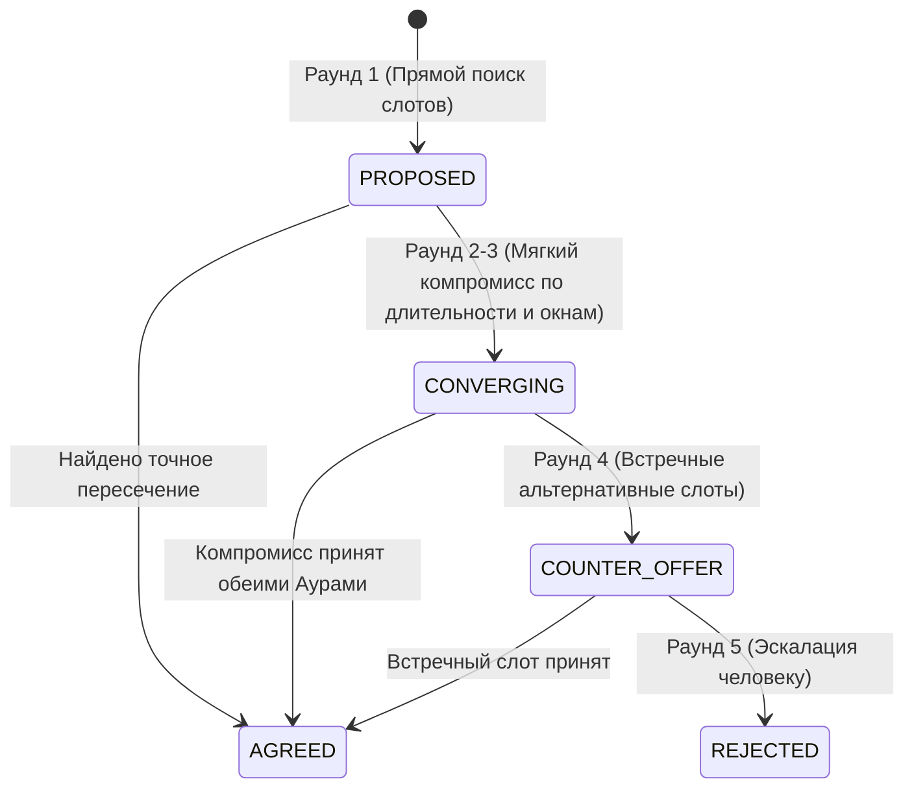

# Протокол Aura Agent-to-Agent (A2A & AFP)

Архитектура глобальной сети децентрализованных персональных цифровых двойников (ИИ-агентов Aura).

---

## 1. Архитектура децентрализованной сети (Aura Federation Protocol — AFP)

Сеть Аур строится как федерация независимых персональных узлов, серверов и локальных устройств (десктоп, мобильный телефон):
* **Адресация агентов**: форма `@username:domain.tld` (по аналогии с Matrix / ActivityPub / DID).
* **Обнаружение (Discovery)**: эндпоинт `GET /.well-known/aura-agent?user=username`. Возвращает манифест узла: публичный ключ Ed25519, `inbox_url` и поддерживаемые возможности (`capabilities`).
* **Криптографическая подпись (Ed25519)**: каждое межсерверное сообщение упаковывается в канонический конверт (Envelope) и подписывается приватным ключом узла/агента.
* **Защита от Replay-атак**: окно валидности временной метки ($\pm 300$ с) + уникальный одноразовый идентификатор `nonce` с проверкой по кэшу.

### Формат федеративного конверта (Signed Envelope)

```json
{
  "sender": "@alex:aura.me",
  "recipient": "@elena:aura.org",
  "timestamp": 1729375200,
  "nonce": "9a3f2b18c4e51082",
  "intent": "schedule_meeting",
  "payload": {
    "topic": "обсудить стартап",
    "duration_minutes": 60,
    "window_hours": 96,
    "multi_turn": true
  },
  "signature": "3045022100e4d7...ed25519_hex..."
}
```

---

## 2. Поиск реальных мест и диспетчер бронирования

Вместо захардкоженного списка заведений система использует динамический гео-поисковый движок:
1. **OpenStreetMap Overpass API**: поиск кафе, ресторанов и бистро вокруг середины пути (`midpoint`) между координатами участников.
2. **Геокодирование**: Nominatim / кэш координат городов.
3. **Фильтрация и скоринг**:
   - Диетические предпочтения: `vegan`, `vegetarian`, `halal`, `gluten_free`.
   - Ценовой диапазон (`price_level`).
   - Наличие рабочего пространства / Wi-Fi (`workspace`).
4. **Диспетчер бронирования (BookingDispatcher)**:
   - Интеграция через Webhook с ресторанными агрегаторами / Telegram-ботами ресторанов.
   - Генерация подтвержденного электронного билета бронирования со сгенерированным защитным PIN-кодом.
   - Резервный режим (sandbox fallback) для безопасного офлайн-тестирования.

---

## 3. Многораундовый торг (Multi-Turn Autonomous Negotiation Engine)

Переговоры не останавливаются после одного пинг-понга, а выполняются через автономный конечный автомат (State Machine, до 5 микрораундов):



1. **Раунд 1 (PROPOSED)**: Поиск прямого пересечения свободных интервалов инициатора и респондента.
2. **Раунд 2–3 (CONVERGING)**: Сближение предпочтений — тестирование сокращенной длительности (например, 45 вместо 60 минут) и расширенных временных окон.
3. **Раунд 4 (COUNTER_OFFER)**: Предложение лучших альтернативных окон с учетом весов мягких предпочтений.
4. **Раунд 5 (Эскалация человеку)**: Если за 5 раундов консенсус не достигнут, варианты передаются владельцам для ручного выбора.

---

## 4. Внешние календари и CalDAV

Для предотвращения коллизий с реальными событиями пользователя:
* **CalDAV / iCalendar (RFC 5545)**: нативная поддержка Apple iCloud, Fastmail, Nextcloud, Yandex Календаря и произвольных `.ics` потоков.
* **Google Calendar API**: синхронизация через OAuth 2.0 PKCE с автоматическим обновлением токенов.
* Занятые слоты из внешних календарей автоматически включаются в интервалы занятости (`schedule`), гарантируя актуальность расписания при любых переговорах.

---

## 5. Приватность и поддержка локальных LLM

Философия цифрового двойника Aura требует, чтобы личные секреты, привычки и история встреч не передавались сторонним облакам:
* Поддержка **Ollama**, **vLLM**, **llama.cpp** и любых локальных OpenAI-совместимых эндпоинтов.
* Переключение через окружение:
  ```bash
  SELFVOY_LLM_PROVIDER=ollama
  SELFVOY_LLM_BASE_URL=http://127.0.0.1:11434/v1
  SELFVOY_LLM_MODEL=llama3.2
  ```
* Конфиденциальные данные обрабатываются локально на сервере или устройстве пользователя.

---

## 6. Безопасность и барьер подтверждений

1. Все действия с внешними побочными эффектами (отправка сообщений, реальное бронирование, письма) требуют явного подтверждения владельца (`pending_actions` → `confirmation.approve`) или режима `allow` в `tool_permissions`.
2. Контекст пользователя (память, заметки, история) изолирован: сервер собирает для собеседника только обезличенный интервальный профиль занятости.
